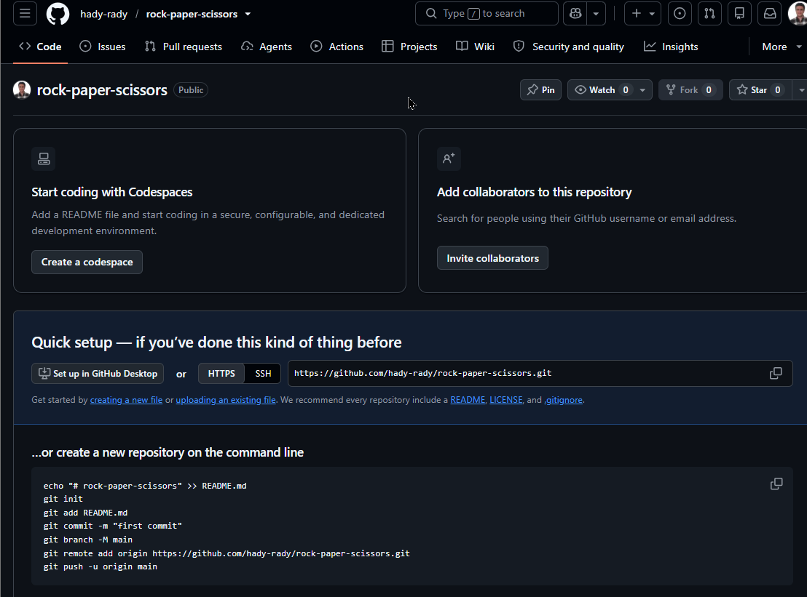

# Rock Paper Scissors

A Python implementation of the classic Rock Paper Scissors game, featuring a player strategy designed to compete against multiple built-in opponents.

## Project Overview

This project was completed as part of the **freeCodeCamp Machine Learning with Python Projects** curriculum. The goal is to implement a `player()` function that predicts opponents' moves and performs well against different playing strategies.

## Project Objective

- Develop a strategic player using Python.
- Analyze opponents' previous moves.
- Test the strategy against multiple built-in opponents.
- Achieve a win rate of at least 60% against each opponent.

## Technologies Used

- Python
- Lists and Dictionaries
- Functions
- Pattern Recognition
- Unit Testing

## Project Structure

| File | Description |
|---|---|
| `RPS.py` | Contains the player strategy and prediction logic. |
| `RPS_game.py` | Contains the game logic and built-in opponents. |
| `test_module.py` | Tests the player against the four opponents. |
| `main.py` | Main project entry point. |

## Results

**Status: All tests passed.**

The player successfully passed all four unit tests against the built-in opponents:

- Quincy
- Abbey
- Kris
- Mrugesh

The recorded test runs showed win rates of approximately 99.8%–100%.

### Test Results Screenshot



## How to Run

Make sure Python is installed and the project files are in the same directory.

Run the game:

```bash
python main.py
```

Run the unit tests:

```bash
python -m unittest test_module.py
```

## Project Category

Python · Game Strategy · Algorithmic Thinking · Unit Testing
